  

 

  
  
  

### The intersection of product & engineering

I'm **Yen-Chun (Selina) Liu**, a Sydney-based Master of IT student at **UTS**. I build Apple-platform applications, data tools and product prototypes, bringing user research and product management experience into software development. I enjoy moving from an ambiguous user problem to a clear workflow, a working implementation and tested outcomes.

**Currently exploring:** SwiftUI architecture · AI with deterministic safeguards · solution engineering · accessibility · data visualisation.

### Selected engineering work

**More work:** [Health In One](https://github.com/ycl2001/health-in-one) · [FridgeFix](https://github.com/ycl2001/fridgefix_assignment2) · [FridgeFit (collaborative)](https://github.com/krischuang/FridgeFit) · [Live dashboard](https://research-block-grant-dashboard-liart.vercel.app/)

### Tools I work with

| Area | Technologies |
|:--|:--|
| **Apple development** | Swift, SwiftUI, Xcode, SwiftData, Core Data, MapKit |
| **Architecture & quality** | MVVM, use cases, repository pattern, Swift Testing, XCTest, GitHub Actions |
| **Data & web** | Python, SQL, JavaScript, HTML/CSS, Plotly, React |
| **Product & collaboration** | Figma, Notion, Postman, Tableau, Power BI |

### Research & responsible AI

**TripCap** explores a hybrid privacy-control model in which AI suggests relevant controls but a **deterministic policy engine** makes the final authorisation decision. I'm interested in explainable, testable systems that translate policy and user needs into usable technology.

### GitHub activity

The activity card is populated from **public GitHub contribution data**, not estimated statistics. It refreshes when the included workflow successfully retrieves GitHub's contribution calendar. [View the live contribution graph](https://github.com/ycl2001?tab=overview).

---

  <strong>Let's connect</strong> 
  <a href="https://github.com/ycl2001">GitHub</a> ·
  <a href="https://research-block-grant-dashboard-liart.vercel.app/">Live data project</a>

