<!-- Moonshade Silver • Editorial animated SVG cards; inspired by Avi Vashishta's GitHub profile layout. -->

 
 
 
 
 

<a href="https://github.com/ycl2001">github</a> &nbsp;·&nbsp; <a href="https://www.linkedin.com/in/ycl2001/">linkedin</a> &nbsp;·&nbsp; <a href="https://research-block-grant-dashboard-liart.vercel.app/">live dashboard</a>

SwiftUI · Privacy-aware AI · Data products · Product engineering

